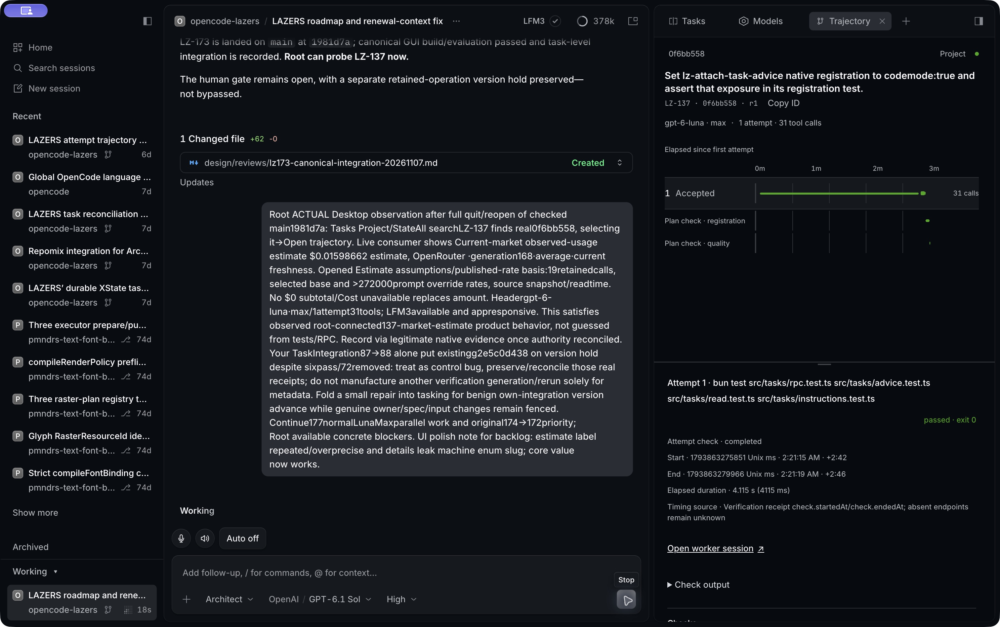

# Connected LZ-137 market estimate

Root drove the actual OpenCode Desktop after fully quitting/reopening it with
canonical `main` at `1981d7a`. This used existing project data; no fixture, task,
worker or usage record was inserted for the observation.

## Observed behavior

1. Tasks → Project → State: All → search `LZ-137` found the actual accepted task
   `0f6bb558-101b-4d57-a9d9-80428df78fce`.
2. Selected the visible task and used **Open trajectory**. The panel identified
   LZ-137/r1, `gpt-6-luna · max`, one attempt and 31 tool calls.
3. The consumer panel displayed **$0.01598662 estimate** as current-market
   observed usage. Its source line showed **OpenRouter · generation168 · average
   · current freshness**.
4. Opened the initially collapsed estimate basis. It identified **19 retained
   calls**, the selected published base/above272000 prompt-token rates and source
   snapshot/read time. Precise assumptions were accessible below the summary.
5. LFM3 was available after reopening and the panel remained responsive during
   navigation. This does not itself claim a new local inference request.

The amount matches the authored approximate0.016USD expectation. Root returned
this observation through the existing native Architect chat. This establishes
the connected consumer behavior, not whole-roadmap completion or historical billing.

## Remaining control and UI findings

- The retained operation is held because recording its own task-level integration
  advanced plan version87→88. All six real task/combined checks passed and all
  72 check resources were removed. Its genuine checks and this observation must
  survive legitimate native reconciliation; no replacement generation or made-up
  original idle result was supplied.
- Selecting the live task by accessibility ID failed twice because row IDs changed
  between observations. A visible-row click worked. This needs stable identity
  investigation in the existing Tasks UI work.
- The price headline repeats “estimate” and prints excessive precision. Expanded
  details expose an internal basis enum slug. Record these consumer wording issues
  for UI refinement; they do not negate the observed correct priced value.
- Reviewed independent fulfillment for stopped zero-attempt bootstrap tasks is
  separately blocked by disposition eligibility. No execution history was rewritten.
