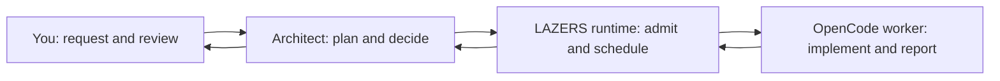

# How the workflow works

LAZERS separates judgment from task state. Architect makes decisions that need context. The runtime owns scheduling and lifecycle transitions.

## You set the goal

Describe the requested behavior and any important limits. OpenCode permissions govern tool calls and workspace access. You review the result and decide when to integrate or publish it.

## Architect plans the work

Architect inspects repository context, resolves material questions, and defines task acceptance before dispatch. One task can cover a coherent change. A plan can split independent work and record dependencies.

Architect reviews returned work and chooses repair, retry, or replanning when new evidence needs judgment. Routine lifecycle transitions do not call a model.

## The runtime manages task state

The runtime admits plans, resolves workers and resources, dispatches eligible tasks, runs required checks, and records evidence. It preserves task and attempt history across retries.

Independent tasks can use OpenCode-managed worktrees. Conflicting write scopes serialize. The runtime applies configured verification timeouts and does not treat a worker report as acceptance.

## Workers implement and report

Each worker runs as a native OpenCode session. Workers implement their assigned task, run its checks, and return changed files, evidence, and unresolved issues. The runtime records the result for Architect review.

## Acceptance and integration are separate

Acceptance records whether the task meets its checks and decisions. Architect reviews accepted work and handles integration. LAZERS does not merge or publish a change just because a worker reports completion.

## Current limits

The v0.1.0 runtime does not dispatch dedicated investigator or researcher roles. Architect can use normal OpenCode tools for repository work and research.

Model cost estimates depend on measured usage and configured price sources. Missing usage or prices stay unknown. The provider budget indicator reports provider usage; it does not enforce a budget.
